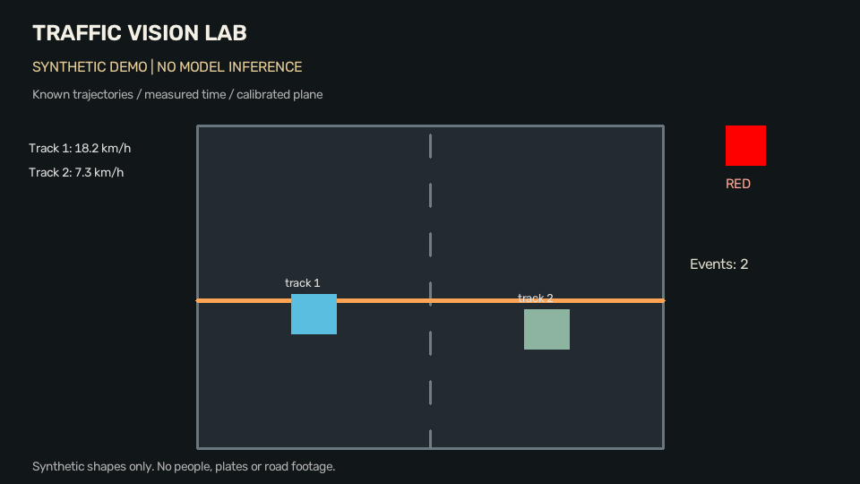
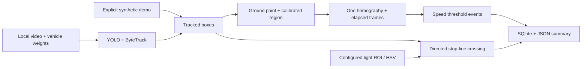

# Traffic Vision Lab

Vehicle tracking, calibrated speed estimation and traffic-event analysis in
Python. A maintained portfolio edition of a **shared graduation project**;
see [project origin and attribution](NOTICE.md).



The preview uses generated shapes and known trajectories. It contains no real
road footage, people or plates, and is **not a model accuracy demonstration**.

## What it does

- Maps a vehicle's ground-contact point from image coordinates to a measured
  road plane with one homography transform.
- Estimates average displacement speed using the actual elapsed frame interval.
- Detects directed crossings of a finite stop-line segment while a configured
  traffic-light region is red, and checks configurable speed thresholds.
- Stores per-run vehicle/event metadata in local SQLite.
- Optionally runs local Ultralytics vehicle weights with ByteTrack and local
  plate weights with Tesseract. OCR text is discarded; only the number of
  successful OCR observations is reported.



## Run the demo

Use **Python 3.12**. The base demo needs NumPy and OpenCV; no trained model,
Tesseract installation, dataset or GPU is required.

```powershell
python -m venv .venv
.\.venv\Scripts\python.exe -m pip install -r requirements.txt
.\.venv\Scripts\python.exe main.py demo --output runs/demo-01
```

On Linux/macOS, use `.venv/bin/python` for the virtual environment commands.
Choose a new output directory for every run; existing directories are rejected.

The three-second demo creates `demo.mp4`, `preview.png`, `summary.json` and
`events.sqlite3`. It contains two known trajectories at 30 FPS. The forward
trajectory travels 15 metres over 89 frame intervals (about 18.2 km/h), producing
one example speed-threshold event and one red-line crossing. These are geometry
checks using predefined boxes, not detections from a trained network.

## Analyze your own local video

Install optional dependencies, then supply your own trusted local `.pt` vehicle
weights and a calibration measured for that camera:

```powershell
.\.venv\Scripts\python.exe -m pip install -r requirements-models.txt
.\.venv\Scripts\python.exe main.py video --input data/clip.mp4 --weights models/vehicles.pt --calibration calibration.local.json --output runs/video-01
```

The runner uses **ByteTrack**, filters the model's class names to the classes in
your configuration and processes vehicles only within the calibrated region.
It saves SQLite metadata and a JSON summary, with no video, crop or raw frame
export. Missing files/dependencies or invalid calibration cause an error; they
never switch to the synthetic demo. Runtime model downloads and package
auto-installation are disabled by the runner.

For optional plate reading, install Tesseract on PATH and add
`--plate-weights models/plates.pt`. The plate model must detect plate boxes.
The OCR filter handles a limited Turkish plate text pattern. It is a format
heuristic, not proof that a registration exists. Reads are counted per crop
observation, not as unique vehicles or recognition accuracy. OCR results are
not associated with vehicle identities or written to the event database.

The original trained weights and footage are not included. Detection accuracy,
OCR accuracy, real traffic speed error and real-time FPS have not been measured
for this edition. See [verification and limitations](docs/verification.md).

## Calibration

Use [examples/calibration.demo.json](examples/calibration.demo.json) to understand
the schema. Its coordinates and thresholds apply **only to the generated demo**.

| Field | Meaning |
| --- | --- |
| `image_size` | Exact input video width and height; frames are not resized. |
| `source_points` | Four pixel corners, ordered top-left, top-right, bottom-right, bottom-left on one road plane. |
| `width_m`, `height_m` | Measured physical distances represented by the rectangular plane. |
| `stop_line` | Two pixel endpoints of the finite monitored line. |
| `light_roi` | `[x1,y1,x2,y2]` crop containing the signal for that monitored lane. |
| `speed_limits_kmh` | Model class names mapped to experiment thresholds; no legal limits are implied. |
| `crossing_direction` | `1` for negative-to-positive signed line side, `-1` for the reverse. |

The signed side is `cross(line_end - line_start, point - line_start)`. For the
demo's left-to-right horizontal line, `1` means top-to-bottom motion. Touching
or stopping on the line does not trigger a crossing. A move to the opposite
side confirms it, using the signal color in that frame. Green, yellow and
unknown colors do not emit red-light events. Each event kind is emitted once
per active track; a gap longer than one second or departure from the region
resets that track's motion state.

Speed uses the first and last ground-contact positions within an approximately
one-second history. At least a quarter-second of observations is required.
Time is `(last_frame - first_frame) / fps`, including gaps between detections.
Use **constant-frame-rate video** with accurate FPS metadata. Variable-frame-rate
timing is not supported or automatically detected. This is a stationary-camera,
single-plane, single-signal prototype, not a calibrated enforcement system.

## Tests

```powershell
.\.venv\Scripts\python.exe -m pip install -r requirements-dev.txt
.\.venv\Scripts\python.exe -m pytest -q
.\.venv\Scripts\python.exe -m ruff check .
.\.venv\Scripts\python.exe -m ruff format --check .
```

Tests cover known metric motion, skipped frames, invalid homographies, crossing
direction, finite segments, waiting on the line, signal ambiguity, OCR result
parsing, database defaults and the complete synthetic video-to-events path.
Model-independent tests run offline; the real-video runner is also tested with
an injected detector. These checks do not establish real-world model quality.

## Data handling and scope

Only the synthetic preview is included. Videos, weights, local calibration,
databases, output folders and environment files are ignored by Git. The CLI
does not accept cameras or remote URLs. It does not export real frames, plate
text, cities or contact information. `TrafficDatabase` also discards those
personal fields by default; its explicit opt-in API is not used by the CLI.

The earlier project combined experimental UI scripts, footage-specific paths
and model fallbacks. This edition consolidates the runner and fixes geometry,
timing, event logic and persistence defaults while preserving the project's
[origin](NOTICE.md) and [MIT license](LICENSE).
